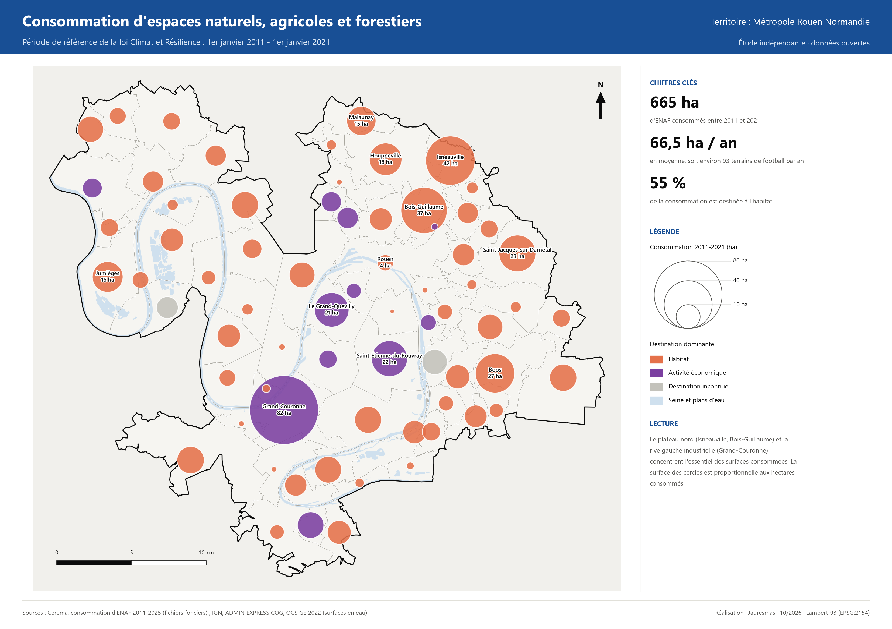
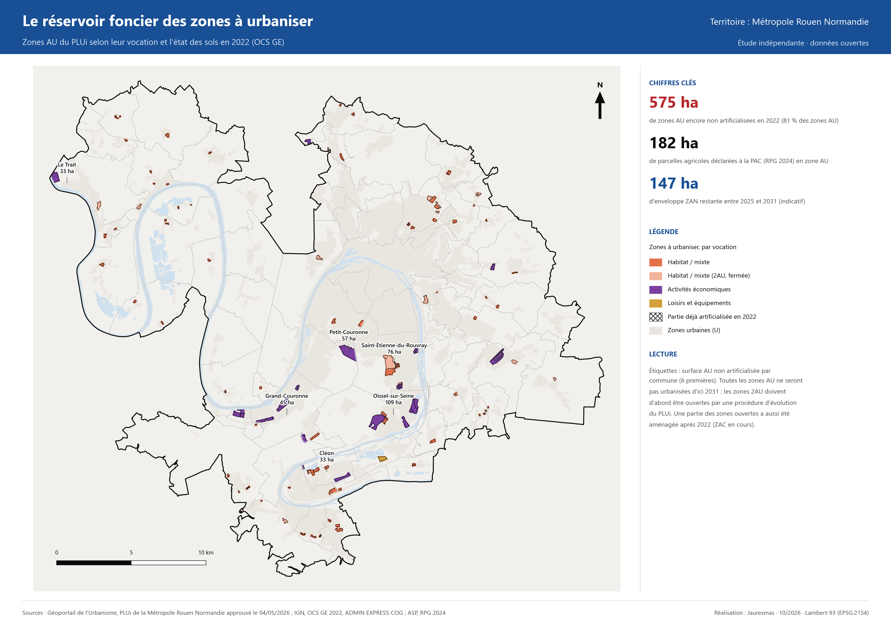
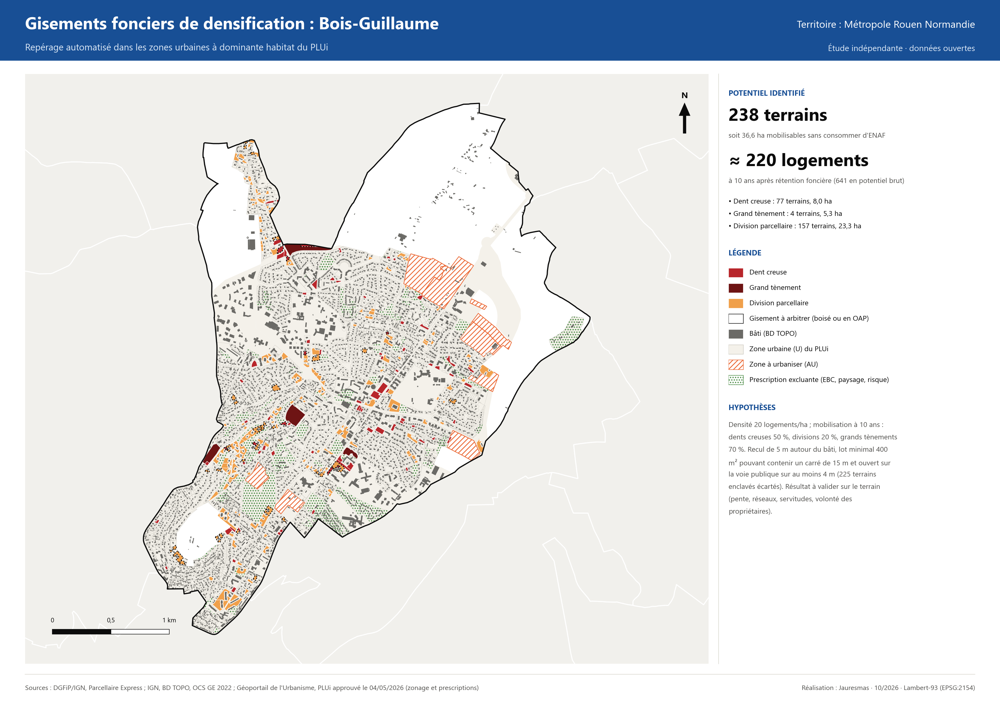
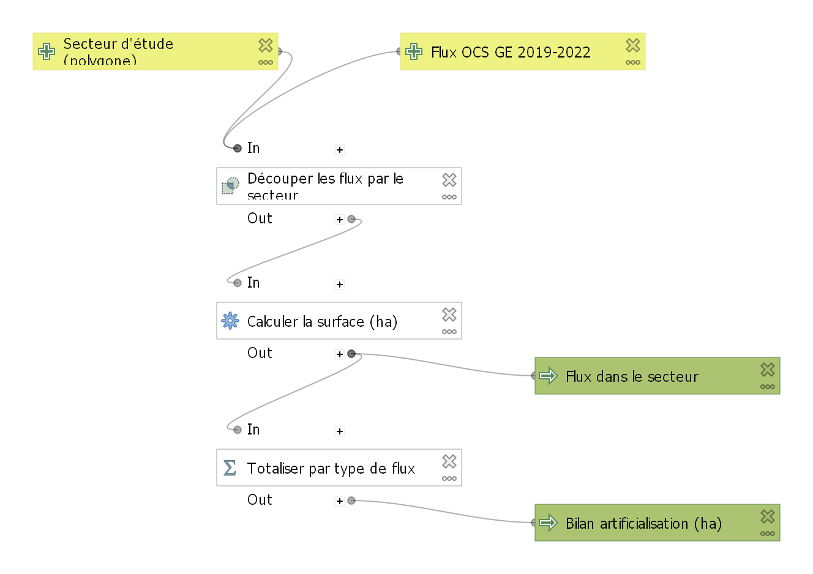
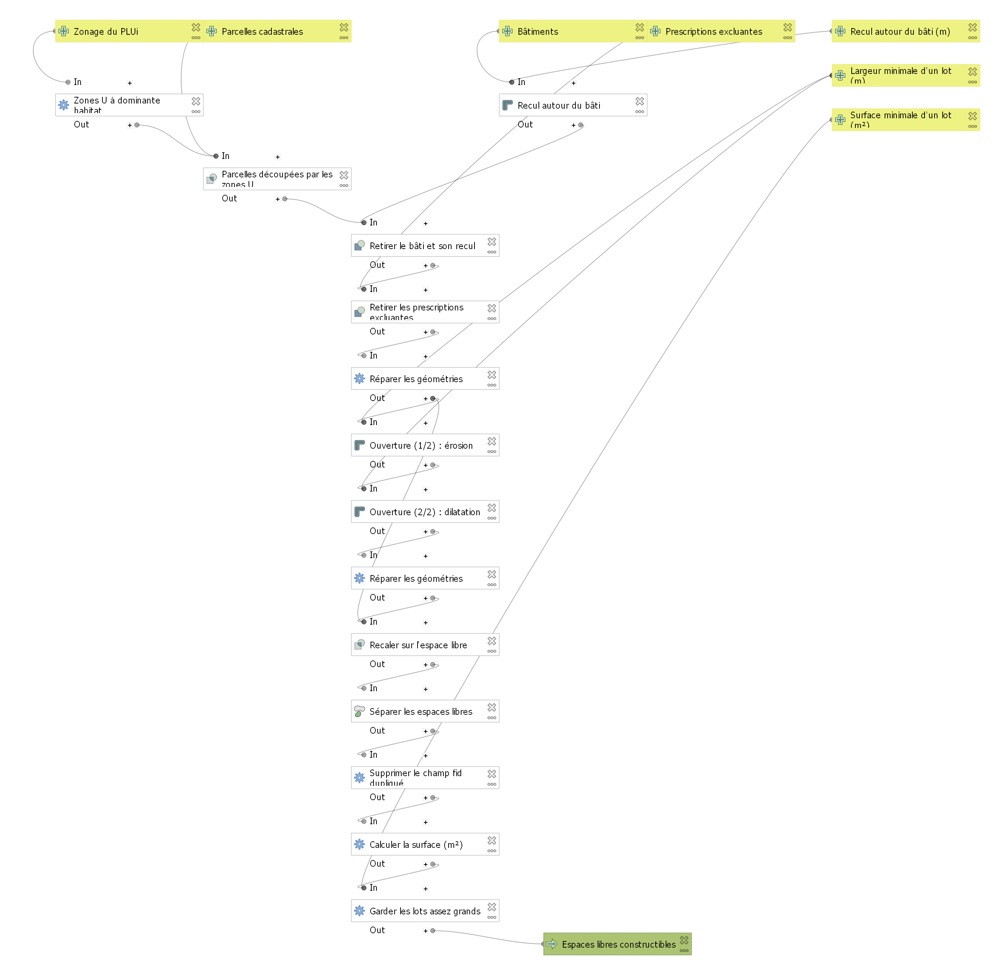

# Diagnostic foncier ZAN · Métropole Rouen Normandie

Ce projet est une chaîne de traitement SIG reproductible. Elle mesure la consommation d'espaces naturels, agricoles et forestiers (ENAF) et l'artificialisation des sols, puis les confronte au PLUi de la Métropole Rouen Normandie dans la perspective du zéro artificialisation nette (ZAN).

Toutes les données sont ouvertes. Le travail est livré sous deux formes complémentaires :

- **une chaîne de scripts Python** qui produit les analyses, les planches, l'atlas, le tableur et les documents, et qu'on peut relancer à chaque nouveau millésime ;
- **un projet QGIS prêt à l'emploi**, avec des mises en page, un atlas communal et deux **modèles du modeleur graphique** pour un usage interactif (voir [Projet QGIS et modeleur graphique](#projet-qgis-et-modeleur-graphique)).

> **Carte interactive :** [ouvrir la carte web](https://jauresmas.github.io/diagnostic-zan-rouen/)
> **Livrables :** [`livrables/`](livrables/), avec le [bordereau de livraison](livrables/01_Documents/00_Bordereau_de_livraison.pdf) et la [note méthodologique](livrables/01_Documents/01_Note_methodologique.pdf)



## Chiffres clés

| Indicateur | Valeur |
|---|---|
| Consommation d'ENAF 2011-2021 (période de référence) | **665 ha**, soit 66,5 ha par an |
| Consommation d'ENAF 2021-2025 | **185 ha**, un rythme en baisse de 30 % (l'objectif est −50 %) |
| Part de l'enveloppe indicative 2021-2031 utilisée au 1er janvier 2025 | **56 %**, après 4 années sur 10 |
| Artificialisation nette 2019-2022 (OCS GE) | **172 ha** |
| Zones à urbaniser (AU) du PLUi encore non artificialisées | **575 ha**, soit 3,9 fois l'enveloppe restante (147 ha) |
| Gisements de densification (Isneauville et Bois-Guillaume) | **366 terrains, 58 ha**, environ 347 logements à 10 ans |

## Les cinq étapes

| Étape | Question | Script | Planches |
|---|---|---|---|
| 1 | Combien d'ENAF ont été consommés depuis 2011, où et pour quoi ? Où en est la trajectoire −50 % ? | [`01_consommation_enaf.py`](scripts/01_consommation_enaf.py) | C01, C02, G01 à G03 |
| 2 | Comment l'occupation du sol a-t-elle évolué entre 2019 et 2022 (artificialisation au sens du décret 2023-1096) ? | [`02_evolution_ocsge.py`](scripts/02_evolution_ocsge.py) | C03, C04, G04 |
| 3 | Le réservoir foncier du PLUi (zones AU) est-il compatible avec l'enveloppe restante ? | [`03_plui_occupation.py`](scripts/03_plui_occupation.py) | C05, C06, G05 |
| 4 | Quel potentiel de densification existe dans les zones urbaines déjà constituées ? | [`04_gisements_densification.py`](scripts/04_gisements_densification.py) | C07, C08 |
| 5 | Automatiser, mettre à jour chaque année, transposer à un autre territoire | [`run_all.py`](scripts/run_all.py), [`config.py`](scripts/config.py) | toutes |

<p>


</p>

## Livrables

| Dossier | Contenu |
|---|---|
| `01_Documents/` | Bordereau de livraison, note méthodologique (environ 15 pages), fiches tutoriel pour les agents |
| `02_Donnees_SIG/` | GeoPackage (QGIS), géodatabase fichier (ArcGIS Pro), projet QGIS (mises en page, atlas, modèles), modèles `.model3`, dictionnaire des données |
| `03_Planches_cartographiques/` | 8 planches A3 au format PDF et PNG |
| `04_Graphiques/` | 5 graphiques d'analyse |
| `05_Tableaux/` | Classeur Excel : synthèse, indicateurs par commune, zones AU, gisements, matrice de transitions |
| `06_Atlas_communal/` | Atlas PDF avec une page par commune (71 communes) |
| `docs/` | Carte web interactive (Leaflet), publiée avec GitHub Pages |

## Reproduire le diagnostic

```bash
python -m venv .venv
.venv\Scripts\activate            # sous Linux/macOS : source .venv/bin/activate
pip install -r requirements.txt
python scripts/run_all.py         # téléchargement, analyses, livrables (environ 15 min)
```

Pour **mettre à jour** le diagnostic quand un nouveau millésime Cerema ou IGN est publié, remplacez les URL dans `config.py` puis relancez `run_all.py`. Pour **transposer** le diagnostic à un autre EPCI, changez `EPCI_SIREN`, `DEPARTEMENT`, les millésimes OCS GE et les communes test.

## Projet QGIS et modeleur graphique

Le projet [`livrables/02_Donnees_SIG/diagnostic_zan_rouen.qgz`](livrables/02_Donnees_SIG/) s'ouvre directement dans QGIS 3.34 ou une version plus récente. Les chemins sont relatifs et le projet n'utilise aucun fond de carte externe. Il contient :

- **6 thèmes de carte**, un par planche, avec la symbologie de la charte (cercles proportionnels, conventions CNIG) ;
- **4 mises en page A3** prêtes à imprimer (consommation d'ENAF, rythme depuis 2021, réservoir des zones AU, densification) ;
- **un atlas communal A4** piloté par les 71 communes, avec la commune mise en avant, une carte de localisation et des indicateurs calculés par expressions ;
- **2 modèles du modeleur graphique**, dans la boîte à outils de traitements (rubrique « Modèles du projet ») et en fichiers [`.model3`](livrables/02_Donnees_SIG/modeles/).

**Modèle 1 : bilan d'artificialisation d'un secteur.** Pour un périmètre de projet, un quartier ou un groupe de communes, il donne les hectares artificialisés et désartificialisés entre 2019 et 2022 (OCS GE). C'est un outil d'appui aux agents : sur Bois-Guillaume, il trouve 4,0 ha artificialisés et 1,6 ha désartificialisés, en 1 seconde.



**Modèle 2 : espaces libres constructibles en zone U.** C'est la méthode de densification de l'étape 4 traduite en modeleur graphique. Elle sélectionne les zones U à dominante habitat, retire le bâti avec un recul, puis les prescriptions excluantes, applique une ouverture morphologique (érosion puis dilatation) et filtre les lots par surface. Le recul, la largeur minimale du lot et la surface minimale sont des paramètres réglables. Le modèle tourne en environ 10 secondes par commune.



Le projet et les modèles se reconstruisent avec [`scripts/07_projet_qgis.py`](scripts/07_projet_qgis.py) et [`scripts/08_modeles_traitement.py`](scripts/08_modeles_traitement.py), à exécuter dans la console Python de QGIS.

## Méthodes en bref

- **Consommation d'ENAF** : flux annuels du Cerema (fichiers fonciers), ventilés par destination. L'enveloppe 2021-2031 est indicative : elle vaut 50 % de 2011-2021, avant territorialisation par le SRADDET et le SCoT.
- **Artificialisation** : chaque polygone de l'OCS GE (couverture × usage) est classé selon la nomenclature du décret n° 2023-1096, sans les seuils de surface. Les flux viennent du produit différentiel 2019-2022 de l'IGN.
- **PLUi** : les 3 241 zones du standard CNIG sont croisées avec l'OCS GE 2022 et le RPG 2024. La vocation des zones AU est déduite des codes de zone.
- **Densification** : le calcul part des parcelles en zone U à dominante habitat. On retire le bâti BD TOPO avec un recul de 5 m et les prescriptions excluantes du PLUi (EBC, patrimoine paysager, cavités souterraines). On applique ensuite une ouverture morphologique (lot de 15 m × 15 m au minimum) et un accès d'au moins 4 m sur la voie. La programmation repose sur des hypothèses de densité et de rétention foncière.
- **Cartographie** : les valeurs absolues sont en cercles proportionnels et les rapports en aplats. Les couleurs suivent les conventions de l'urbanisme (CNIG, MOS) et ont été contrôlées pour les daltonismes.

Les détails, les limites et les précautions d'usage sont dans la [note méthodologique](livrables/01_Documents/01_Note_methodologique.pdf).

## Sources

Cerema, consommation d'ENAF 2011-2025 · IGN : OCS GE 2.0, ADMIN EXPRESS COG, BD TOPO, Parcellaire Express · Géoportail de l'Urbanisme (PLUi approuvé le 04/05/2026) · ASP, RPG 2024 · INSEE.
Les données sont diffusées sous [Licence Ouverte 2.0](https://www.etalab.gouv.fr/licence-ouverte-open-licence/). Fond de la carte web : © IGN, Plan IGN v2.

## Statut et licence

Ce projet personnel a été réalisé à titre de démonstration, à partir de données ouvertes. C'est une **étude indépendante** qui n'engage pas la Métropole Rouen Normandie.
Le code est sous licence [MIT](LICENSE). Les données dérivées sont sous Licence Ouverte 2.0, avec mention des sources ci-dessus.

Réalisation : Jauresmas · octobre 2026
